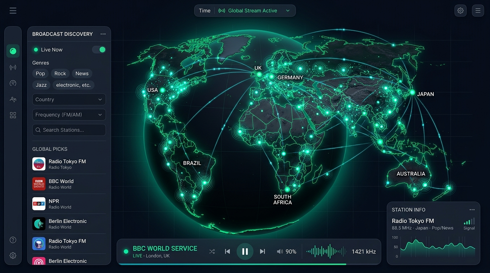
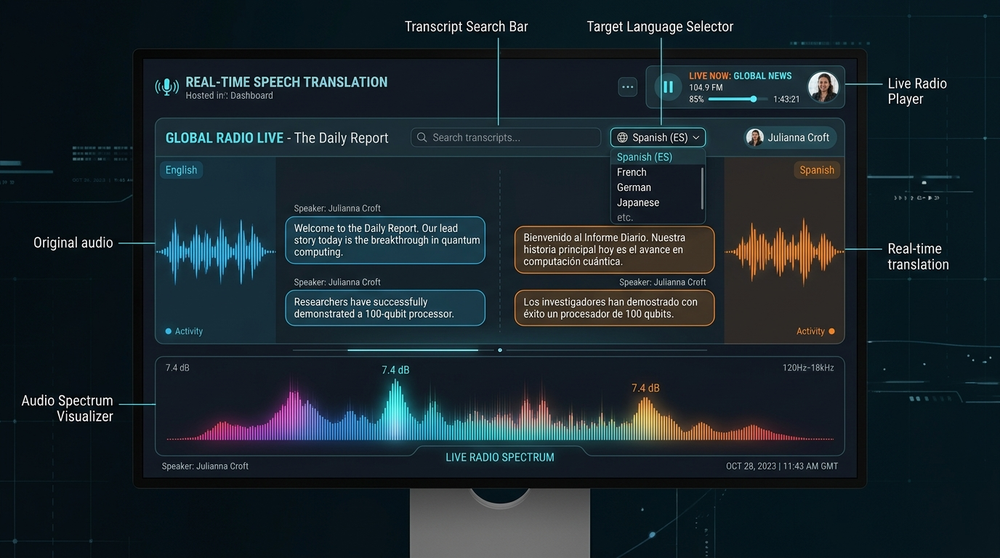
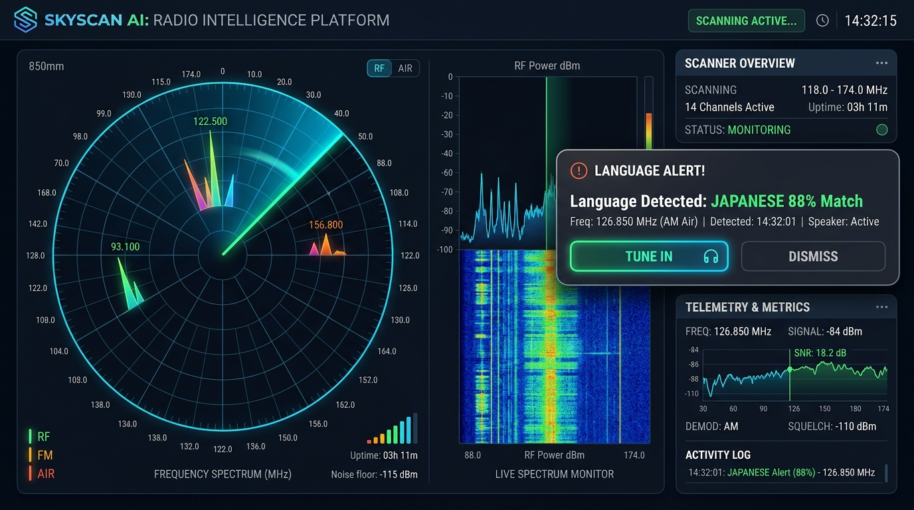
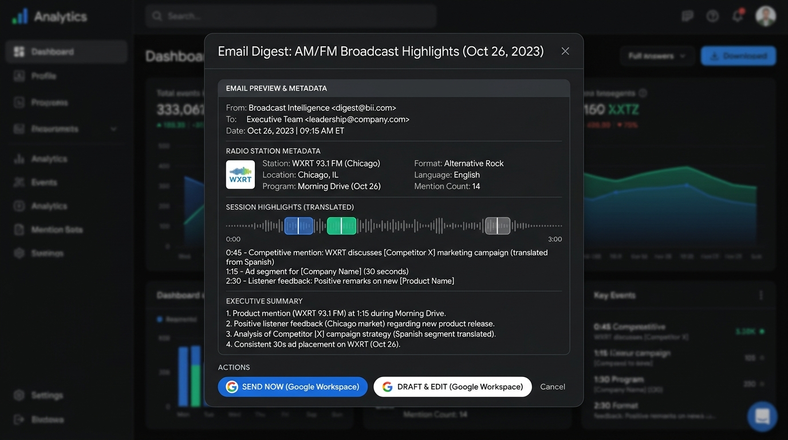
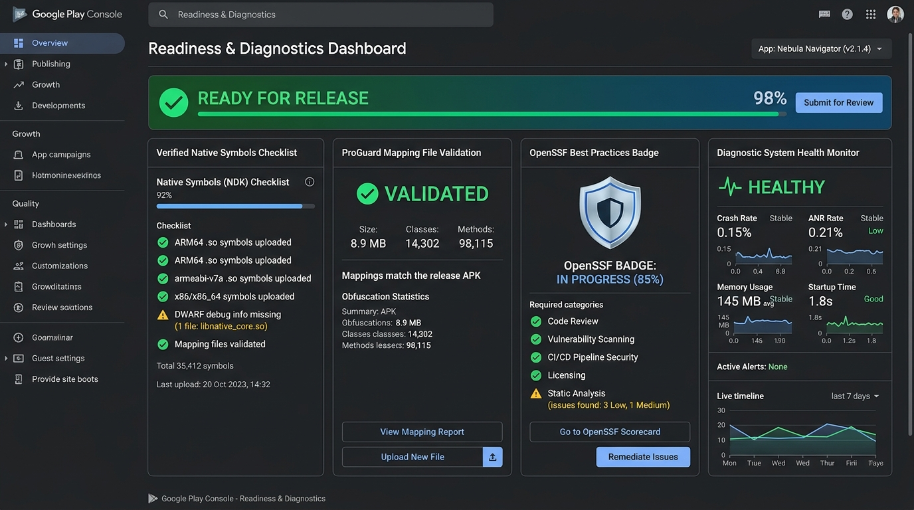
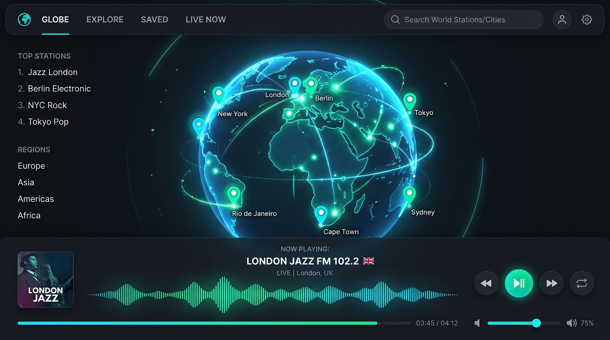
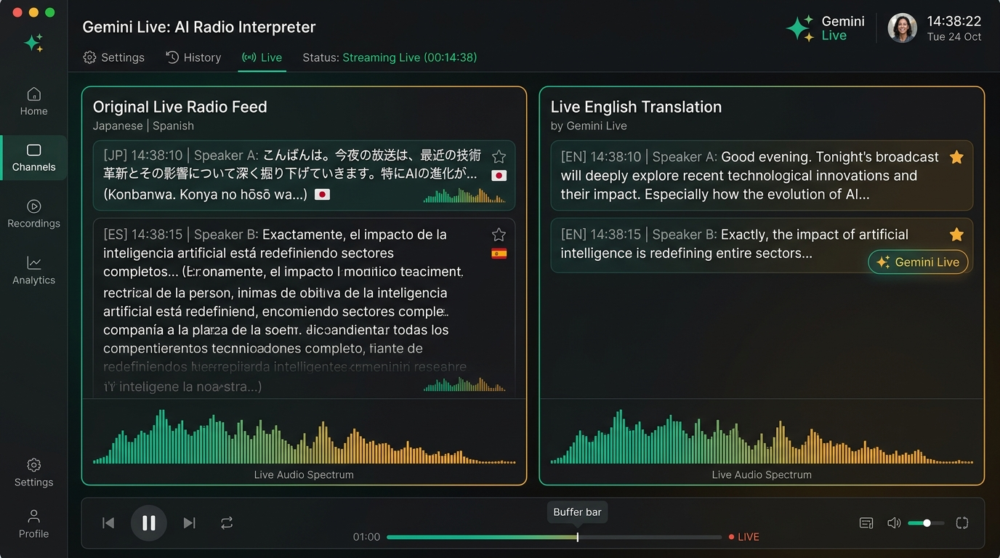
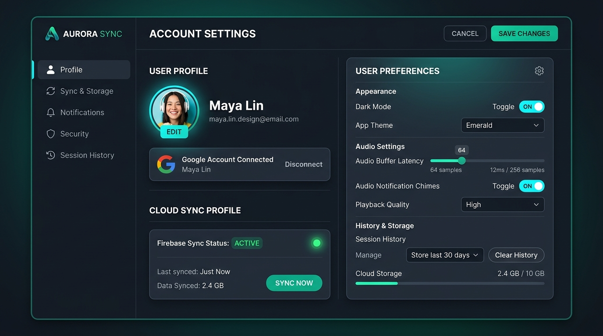
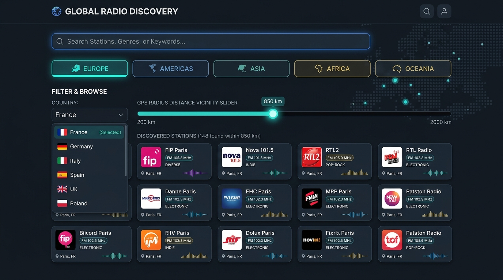
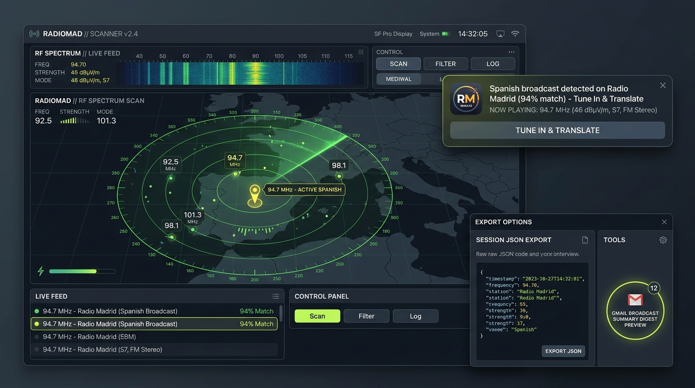

# Remix: World Radio Translator — User's Manual 📖🎧

Welcome to **Remix: World Radio Translator**, your global gateway to streaming live radio broadcasts and continuous podcasts from around the world with real-time AI speech-to-speech translation powered by Google Gemini.

---

## 🗺️ Chapter 1: Global Airwaves Exploration & Interactive Map

### Key Operations:
1. **Explore the 3D Globe / Map**: Drag to pan across continents. Each radiant pulsing node represents an active terrestrial or web broadcast station.
2. **Radius & Vicinity Filtering**: Click anywhere on the map or click **"Detect My Location"** to automatically discover stations broadcasting within 200 km to 2,000 km of your selected coordinates.
3. **Country & Tag Filtering**: Use the country search and genre filters (e.g., News, Talk, Jazz, Electronic, Classical, Pop) to narrow down thousands of airwaves.
4. **Satellite Space-Mesh Relays**: Toggle the **Neural SpaceMesh Satellite Uplink** to route your streams through simulated low-latency orbital relays with adaptive WiFi noise cancellation.

---

## 🎙️ Chapter 2: Real-Time Speech Translation & Live Subtitles

### Key Operations:
1. **Start Live Translation**: Click the **"Live Translate"** button. The app establishes a low-latency 16 kHz PCM WebSocket audio pipeline directly to Google Gemini Live API.
2. **Select Target Language**: Pick from over 50 supported global languages (Spanish, French, Japanese, German, Arabic, Hindi, Mandarin, Russian, etc.).
3. **Smart Language Detection**: The built-in neural detector automatically analyzes incoming speech. If the broadcaster switches languages or speaks a dialect different from your target, a suggestion banner appears with a 1-click button to tune your target language.
4. **Transcript Keyword Search**: Search recent transcript turns with case-insensitive highlighting across both the original spoken foreign dialogue and the translated interpretation.
5. **Bookmark Important Quotes**: Click the star icon next to any turn to save it to your persistent favorites for offline review or sharing.

---

## 📡 Chapter 3: Background Airwaves Scanner & Custom Language Alerts

### Key Operations:
1. **Background Airwaves Scanning**: Enable the **Background Scanner** to autonomously probe regional and global radio stations in the background while you listen.
2. **Configure Custom Language Alerts**:
   - Choose the languages you want to monitor (e.g., Spanish, Japanese, French).
   - Set the minimum detection confidence threshold (50% to 95%).
   - Select notification methods: In-app Toast Banner, Synthesized Radio Audio Chime, or Auto-Tune.
3. **Interactive Toast Notifications**:
   - When a station broadcasting in your target language is found, a radar toast notification appears with the station name, country, and confidence match.
   - Click **"Tune In & Translate"** to immediately switch station playback and live translation to that broadcast.
4. **Detection History Log**: Access the **Detection Log** tab inside the Language Alerts modal to review all recent triggers with timestamps and direct tune-in shortcuts.

---

## ✉️ Chapter 4: Google Workspace Gmail Digest & AI Intelligence

### Key Operations:
1. **Generate Broadcast Summaries**: Click **"Summarize 10-Min Window"** to have Gemini analyze the recent transcript stream and produce a concise executive brief with core topics, speaker viewpoints, and key quotes.
2. **Send via Gmail**: Click **"Email via Gmail"** in the navigation header or inside the transcript summary modal.
3. **HTML Email Preview**: Toggle between rendered preview and formatted HTML. Includes station branding, stream links, target language, and full transcript turns formatted with RFC 2822 base64url compliance.
4. **Save Draft or Send Directly**: Save the broadcast digest into your Gmail Drafts folder or dispatch it immediately to teammates, researchers, or language learners with explicit confirmation safety guards.

---

## 🛡️ Chapter 5: Play Store Diagnostics, Offline Export & Security

### Key Operations:
1. **Google Play Store Diagnostics**: Access the **Play Store & ProGuard** tab to verify package configurations, target SDK 34, native debug symbols (`ndk { debugSymbolLevel 'FULL' }`), and 64-bit ABI compliance.
2. **ANR & Symbol Verification**: Run the interactive diagnostic simulator to test main-thread responsiveness and verify crash symbolication.
3. **Save Full Session (JSON)**: Export your complete broadcast session (station metadata, transcript turns, bookmarks, and detection results) as a standalone OpenSSF-compliant JSON archive.
4. **Deep-Link Session Sharing**: Generate deep-link URLs to invite friends and colleagues to listen and translate the same broadcast simultaneously.
5. **OpenSSF Security Compliance**: Verified against all 19 criteria of the OpenSSF Best Practices badge with active HSTS, SSRF protection, and zero high/critical vulnerabilities.

---

## 📱 Visual Guide: App Instructions, Account Settings & Regional Airwaves

This reference guide details the 5 foundational workflows illustrated in `README.md`:

### 1. Interactive Globe & Stream Tuning

- **Tuning Frequencies**: Click on station nodes across continents. Audio streams through the Node.js SSRF proxy with CORS headers.
- **Spectrum Visualizer**: Canvas-based real-time audio spectrum analyzer responding to live broadcasts.
- **Radio vs. Podcasts**: Switch between live music stations and 24/7 spoken journalism shows (BBC, NPR, DW, NHK).

### 2. Live Speech Translation & Dual Subtitles

- **Real-Time WebSocket Audio Pipeline**: Streams 16 kHz 16-bit mono PCM chunks directly to Google Gemini Live API.
- **50+ Target Languages**: Live interpretation to Spanish, French, German, Japanese, Hindi, Mandarin, Arabic, etc.
- **Dual-Channel Display**: Original foreign audio transcript on the left, translated text on the right.

### 3. Account Settings, Google Profile & Firebase Cloud Sync

- **Google Authentication**: Single-click sign-in via Firebase Auth (`userConfirmedInUI: true`).
- **Cloud Sync Status**: Automatic bidirectional synchronization with Firestore (`ai-studio-remixworldradiot-28a8ed3a-4334-4619-a1bf-dff6e3de5527`).
- **Audio Preferences**: Fine-tune audio buffer latency (12 ms to 256 samples), alert chimes, dark mode, and retention rules.

### 4. Regional & Country Airwaves Discovery

- **Continental Tabs**: Europe, Americas, Asia, Africa, and Oceania.
- **Country Dropdown with Flags**: Filter by sovereign nations with official languages and verified broadcast streams.
- **GPS Vicinity Radius (200-2000 km)**: Great Circle radial scanning for regional and municipal stations.

### 5. Background Scanner, Language Alerts & Session Export

- **Background Scanner**: Autonomous airwaves probing with configurable confidence thresholds.
- **Custom Language Alert Toasts**: In-app radar toasts with 1-click "Tune In & Translate".
- **Session Export & Gmail Digest**: Standalone JSON export (`#btn-save-full-session`) and Gmail RFC 2822 digest dispatch.

